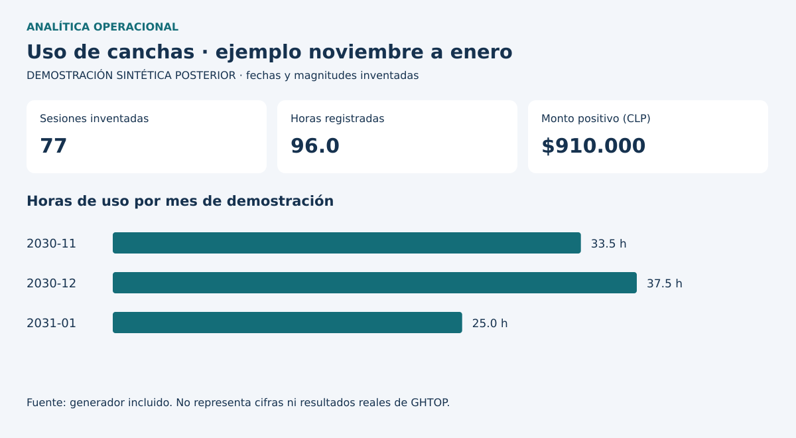

# Analítica operacional de un club deportivo

**Ignacio Pizarro Hurtado · Excel, Power BI y control de gestión**

Este caso documenta cómo utilicé registros operacionales y comerciales de GHTOP para analizar actividad, uso de canchas y montos registrados. Reúne dos trabajos independientes: noviembre de 2025 a enero de 2026 y marzo a junio de 2026. Cada uno conserva su propio alcance y sus definiciones.



**La imagen y los datos de este repositorio son una demostración sintética posterior.** No muestran cifras reales ni reproducen los dashboards históricos.

## Preguntas de gestión

- ¿Cómo se distribuye la actividad por deporte, día y horario?
- ¿Qué significa ingreso en cada informe y qué filas entran en el cálculo?
- ¿Cómo se interpreta el ticket cuando hay registros sin cobro o meses parciales?

## Mi participación

En la administración del club desarrollé reportería en Excel y Power BI. Los proyectos disponibles permiten revisar consultas Power Query, medidas DAX, filtros, relaciones y visualizaciones. La revisión posterior identificó diferencias entre montos por pagar, importes positivos registrados y recuentos de campos de texto. Estos conceptos requieren etiquetas y denominadores explícitos.

Según mi relato, utilicé los análisis para orientar actividades y promociones en días de menor demanda. También reporté restricciones por lluvia. La evidencia disponible no permite cuantificar el efecto causal de esas decisiones.

## Recorrido

| Contenido | Para qué sirve |
|---|---|
| [Noviembre–enero](casos/01_noviembre_enero.md) | Demanda, duración, importes y estados de pago |
| [Marzo–junio](casos/02_marzo_junio.md) | Líneas de negocio, filtros y ticket por registro |
| [Definiciones](documentacion/indicadores.md) | Fórmula, universo y límites de cada concepto |
| [Diseño y modelo](documentacion/diseno_y_modelo.md) | Rediseño posterior y separación de los modelos |
| [Demostración](documentacion/demostracion.md) | Generación desde cero, código y controles |
| [Fuentes y límites](documentacion/fuentes_y_limites.md) | Evidencia histórica frente a desarrollo actual |

## Reproducir el ejemplo

```bash
python src/demostracion.py
python -m unittest discover -s tests -v
```

Los ejemplos DAX/M y el tema en `powerbi/` son nuevos. Las copias privadas PBIP rediseñadas requieren validación en Power BI Desktop y no forman parte de este repositorio.

El proyecto acredita análisis y reportería sobre un contexto operacional acotado. No se presentan como demostrados despliegue empresarial, RLS, optimización medida ni capacidades senior. [Autoría y uso](AUTORIA_Y_USO.md).
