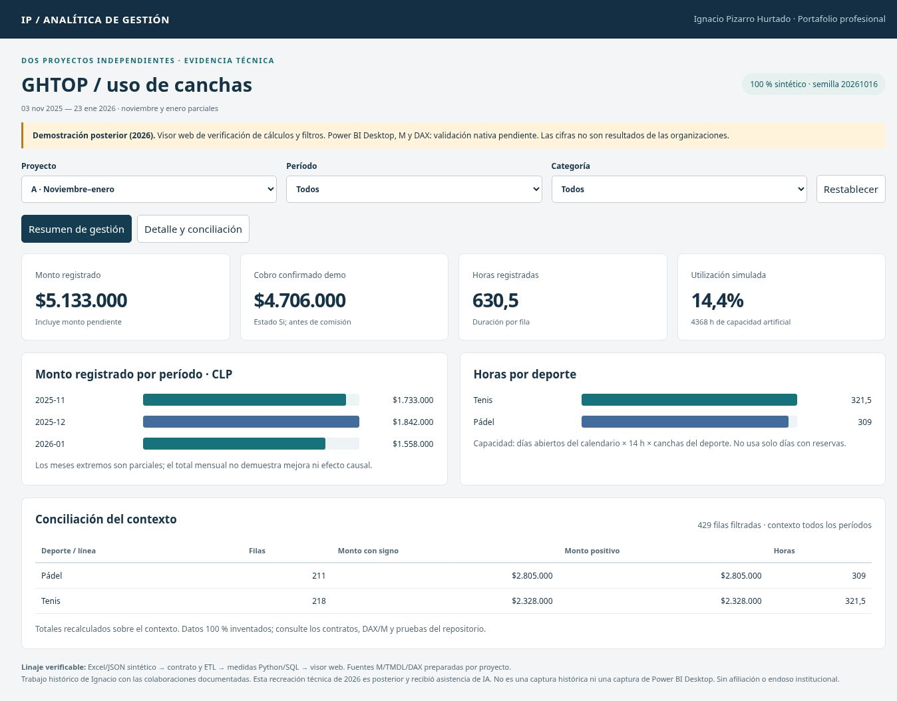

# GHTOP · Analítica operacional y control de gestión

**Ignacio Pizarro Hurtado · Power BI · DAX · Power Query · modelamiento y calidad**

Desarrollé los dashboards históricos de GHTOP para analizar uso de canchas, actividad y montos registrados en la administración del club. Este portafolio continúa ese trabajo con dos proyectos independientes: **A, noviembre 2025–enero 2026**, y **B, marzo–junio 2026**. La reconstrucción de 2026 conserva el contrato de las tablas y utiliza registros totalmente inventados.



*Captura del visor web posterior, calculado sobre el esquema completo. No es Power BI Desktop ni una captura histórica.

## Mi trabajo y la evolución técnica

El trabajo histórico incluye reportería Excel/Power BI, consultas M, medidas DAX y visuales de actividad e importes. En la evolución actual explicito qué mide cada suma, separo monto por pagar de cobro confirmado, controlo el denominador de utilización y distingo movimientos de transacciones. Las decisiones y sus límites son revisables en el código y los casos.

| Ver en tres minutos | Evidencia |
|---|---|
| [Proyecto A](casos/01_noviembre_enero.md) | Cobro, estado de pago, duración, calendario y capacidad sintética |
| [Proyecto B](casos/02_marzo_junio.md) | Exclusiones, movimientos con signo y promedio por registro positivo |
| [Modelo y ETL](documentacion/diseno_y_modelo.md) | Dos estrellas pequeñas, granos y relaciones en una dirección |
| [DAX y M completos](powerbi/modelos/) | Especificaciones y TMDL separados A/B; ejecución nativa pendiente |
| [KPI](documentacion/indicadores.md) | Numeradores, denominadores, filtros y pruebas |
| [Antes / versión actual](documentacion/evolucion_2026.md) | Continuidad, correcciones y ampliaciones justificadas |

## Explorar y reproducir

[**Visor interactivo público**](https://ipizarroh.github.io/analitica-operacional-ghtop/) · [HTML autocontenido](demo/index.html) · [Excel A](datos_compatibles/GHTOP_A_sintetico.xlsx) · [Excel B](datos_compatibles/GHTOP_B_sintetico.xlsx)

```bash
python src/generar_esquema.py --seed 20261016
python src/construir_web.py
python -m pip install -r requirements-dev.txt
python -m unittest discover -s tests -v
node tests/test_web.mjs
```

Abra `demo/index.html` en el navegador. No requiere servidor ni transmite información. El generador Python es autosuficiente; el exportador Excel usa el runtime `@oai/artifact-tool`, documentado en [reproducción](documentacion/demostracion.md). Ambos Excel ya se entregan creados y comprobados.

**Compuerta Power BI:** los dos PBIP completos se entregan privadamente como `PENDIENTE_VALIDACION_DESKTOP`. No se distribuyen como informes funcionales verificados. Los fuentes semánticos publicables permiten revisar las medidas y el modelo; [la guía nativa](documentacion/GUIA_VALIDACION_DESKTOP.md) especifica cómo completar la prueba. Los tests Python/SQL/JavaScript y de Excel no ejecutan DAX ni M.

Los importes, clientes, frecuencias y cierres son artificiales. No prueban impacto comercial, causalidad de promociones o clima, ni rendimiento medido. [Autoría](AUTORIA_Y_USO.md) · [Verificación](VERIFICACION.md) · [Fuentes y límites](documentacion/fuentes_y_limites.md).
