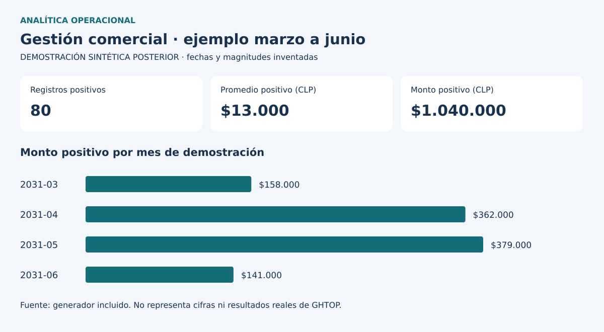

# Demostración sintética posterior

`src/demostracion.py` genera dos CSV independientes y sus SVG/resúmenes JSON. Usa reglas deterministas y datos inventados de 2030–2031 para impedir confundirlos con los períodos históricos. No lee fuentes privadas ni usa parámetros aprendidos de ellas.

Una fila representa una sesión inventada con ID único, fecha, deporte, horas y monto registrado. Para simplificar el ejemplo se denomina cobro positivo a un importe mayor que cero. No hay clientes ni tributación.

| Campo | Tipo | Regla |
|---|---|---|
| id | Texto | Único dentro de cada muestra |
| fecha | Fecha ISO | Dentro de su período de demostración |
| deporte | Texto | Tenis o Pádel |
| horas | Número | Duración positiva inventada |
| monto_clp | Entero | Importe sintético; puede ser cero |

El resumen informa monto positivo, filas positivas, promedio con `null` cuando falta denominador y horas. Las pruebas rechazan claves repetidas y duración negativa. Verifican que importes cero/negativos no entren al ticket positivo y que un conjunto vacío no se convierta en ticket observado cero.

`powerbi/importar_demo.pq` recibe `RutaCSV`, promueve encabezados y tipa el archivo. Cargar una muestra por vez en una tabla llamada `ReservasDemo`. `medidas_demo.dax` contiene medidas nuevas que requieren validación manual. Se propone una tabla calendario propia si el ejemplo se amplía; no se ha implementado ni probado un PBIX público.

