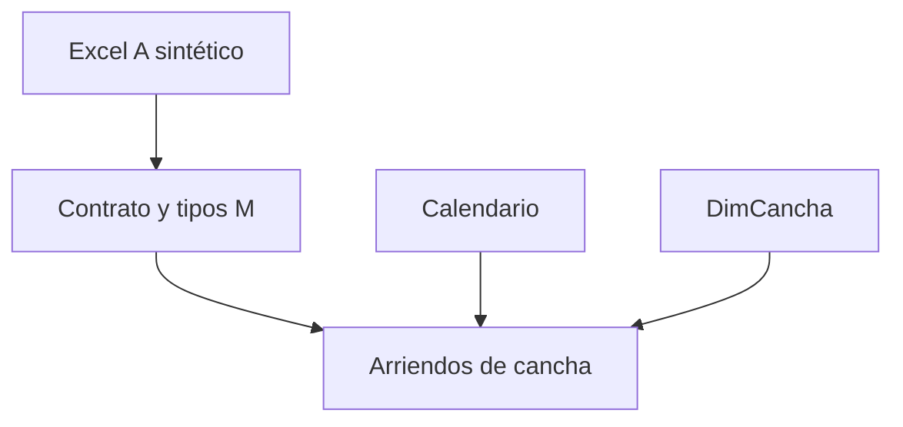
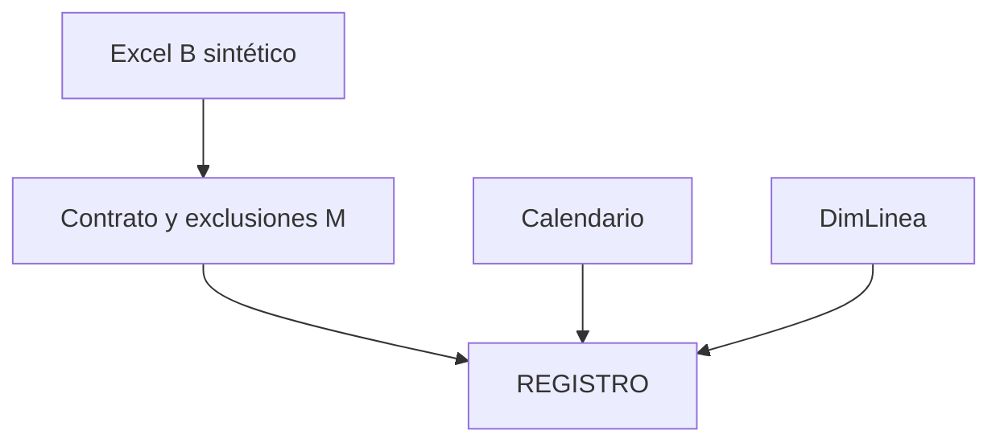

# Arquitectura y linaje de los dos proyectos

Los modelos históricos son independientes y se mantienen así. No se combinan campos con semánticas diferentes para formar un falso historial único. La reconstrucción parte de sus contratos M y referencias visuales, conservados en copias privadas de los PBIP; reemplaza las fuentes y elimina cachés y estado local.

## Proyecto A

Hecho: una fila de uso de cancha con ID artificial único. Esa unicidad es una garantía del generador y **no se presume para los IDs históricos**. Conserva los 17 campos operativos y añade `Cancha original`, `Horas de Uso`, día y orden de semana. La columna `Cancha` conserva la normalización histórica a deporte; la nueva clave `Cancha original` mantiene el detalle T1/T2/P1/P2.

Relaciones: `Calendario[Fecha] 1 → * hecho[Fecha]`, `DimCancha[Cancha] 1 → * hecho[Cancha original]`, ambas en una dirección. Usar `DimCancha[Deporte]` y `Calendario[Mes]` en filtros y categorías. Filtrar deporte en el hecho no filtra de regreso la dimensión y alteraría el denominador de capacidad; por eso no se propone esa interacción.

Calendario: todos los días del intervalo cubierto, incluidos días sin actividad y cierres artificiales. No es un calendario anual completo para time intelligence clásica; las comparaciones implementadas usan ventanas explícitas. La capacidad es suma de horas abiertas por cancha × canchas seleccionadas, con 14 h/día inventadas. No hay calendario operacional histórico suficiente para certificar ocupación real ni ajustar lluvia.

## Proyecto B

Hecho: movimiento de registro; una fila no equivale a reserva o transacción. ID artificial nuevo como extensión documentada, no clave histórica recuperada. No se conecta cliente o cancha como si cada movimiento los tuviera: clases, academia y gastos pueden carecer de horario/cancha/cliente. `DimLinea` se deriva de categorías del hecho ya filtrado; evita catálogo divergente. Calendario y línea filtran 1:* en una dirección. No se calcula ocupación B sin definir qué líneas y horarios representan uso de recursos.

## ETL y tipos

RAW sintético inmutable para una semilla (`fuentes_sinteticas.json`, CSV, Excel) → selección explícita de columnas con `MissingField.Error` → tipos → exclusiones → normalización → campos derivados → modelo. A: cabecera en fila 1, 39 columnas físicas, 17 operativas; B: título fila 1, cabecera fila 2, 21 físicas, 18 operativas seguras (incluye ID nuevo). Las columnas vacías restantes se ignoran; no se depende de sus nombres para eliminar información válida.

A conserva selección por hora de inicio no nula y normalización de cancha. Horas por fila = duración término–inicio; reemplaza dependencia indirecta de una medida de mínimos agregados para hacer explícito el grano, sin declarar demostrado que todos los cálculos históricos fueran erróneos. B conserva fecha no nula, exclusión TIENDA, PAGO G3 y COPA LITORAL y normalización ESCALERILLA → ESCALERILLA TENIS.

Fechas son date, horas time, importes numéricos/Currency.Type. Un campo reservado se remapea a `Participación administración (demo)`: su nombre y regla son nuevos y su valor se genera de manera independiente. El mapeo original solo existe en auditoría privada. El 15% de la demo no es condición contractual real. Los nulos válidos se especifican en cada `contrato.json`.

## Calidad, seguridad y mantenimiento

`src/calidad.py` bloquea esquema/orden, IDs duplicados, FK, intervalos fuera de horario, solapamiento por cancha, recepción incoherente y contactos/rutas. Las mutaciones de tests prueban que las reglas detectan defectos; varios seeds verifican que no dependen del fixture principal. SQL calcula por separado los agregados y exclusiones en 32 contextos (el visor además se contrasta con Python).

Sin RLS, incremental refresh o optimización medida: el caso público no requiere una simulación de esas capacidades. Para producción se necesitarían contrato de fuente, responsables, retención y permisos. No hay archivos `.abf`, caché ni fuente privada en este repositorio. Cambiar el esquema exige revisar contrato, M, pruebas, TMDL y expectativas antes de actualizar una captura.
